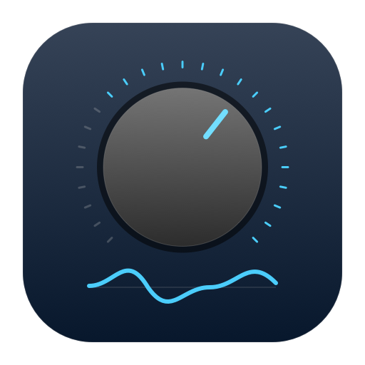

# ADI-2 Control for Linux

**Native macOS app:** [ADI-2 Companion](macOS/README.md) adds a SwiftUI/CoreMIDI
interface, portable EQ profiles and sandboxed packaging. It is currently a
development build; physical hardware and App Store release qualification are
tracked in the [submission guide](macOS/APP_STORE.md).



A native GTK4 remote, EQ builder, and bit-perfect PipeWire setup for the
**RME ADI-2 DAC / Pro / 2/4 Pro** — the control surface RME only ships for
Windows and macOS, built on RME's own published MIDI protocol.


## Why

On Linux the ADI-2 works as a class-compliant USB DAC, but everything in
its DSP — the 5-band parametric EQ, Bass/Treble, Loudness, crossfeed, DA
filters, device setups — is normally only reachable by menu-diving the
unit's two knobs, or from RME's ADI-2 Remote app on another OS. This
project puts all of it in a desktop app, and adds the PipeWire
configuration that makes the DAC reclock per track instead of resampling
everything to 48 kHz.

## What it does

- **Full parameter surface** over USB-MIDI SysEx: Line Out, Phones 1/2,
  Phones 3/4 and (Pro) Input channels; device settings; remapped keys.
  The registry is generated from RME's official MIDITable (v1.2,
  2026-10-30), and the wire encoding is unit-tested byte-for-byte
  against RME's worked examples.
- **Graphical 5-band EQ** per output: live response curve (summed plus
  per-band), drag band points to set frequency/gain, type/gain/freq/Q
  per band, Bass/Treble and Loudness switches.
- **Sync both ways**: reads the full device state on connect (219
  parameters on a DAC) and sends every edit immediately; front-panel
  knob changes on the unit are picked up on the next **Sync** (the app
  does not hold the ALSA raw-MIDI port open between transfers). Works
  fully offline as a profile builder when no DAC is attached.
- **Watches for the unit**: auto-connects and syncs at launch, notices
  within ~3 seconds when the DAC is switched on or off, and
  reconnects by itself. (The protocol has no remote power command and
  the MIDI port vanishes when the unit is off, so the app cannot
  switch the hardware on — nothing on USB can.)
- **Imports the EQ files you already have**: Equalizer APO / Peace and
  REW filter text, AutoEq and Squiglink ParametricEQ files, CSV
  measurements, and AutoEq-style JSON. Ten-band presets are reduced to
  the ADI-2's five bands keeping the strongest filters, and every
  dropped, clamped, or adjusted value is reported — including preamps,
  which have no on-device equivalent. Import from any output page.
- **Presets everywhere**: save/load the ADI-2's 20 on-device EQ preset
  slots (with names) and its 9 device setups, plus shareable local JSON
  profiles in `~/.config/rme-adi2/profiles`. (Local profiles and live
  channel EQ writes are hardware-verified; on-device preset slot writes
  follow the MIDITable spec and have not been live-tested.)
- **Recreated EQ builder CLI** (`tools/build_eq.py`): turns a profile
  JSON into a SysEx block, prints/writes/sends it. Ships with the
  Beyerdynamic DT 1990 Pro (analytic pads) studio-reference profile —
  oratory1990's 10-band AutoEq preset reduced to the ADI-2's five
  bands, deployed and verified on real hardware.

## Requirements

- Linux with ALSA (`alsa-utils` for `amidi`), Python ≥ 3.10, GTK4 +
  libadwaita (PyGObject). On Ubuntu: `sudo apt install python3-gi python3-gi-cairo
  gir1.2-gtk-4.0 gir1.2-adw-1 alsa-utils`
- On the ADI-2: **Setup → Device Mode / DSD → MIDI Control = On**
  (on the DAC: SETUP → Options → Device Mode / DSD), connected by USB.

## Install

**Ubuntu 24.04 or newer, or Debian 13:** download
`rme-adi2-control_1.1.0_all.deb` from the
[latest release](https://github.com/spencernorton/rme-adi2-linux/releases/latest) and run

```bash
sudo apt install ./rme-adi2-control_1.1.0_all.deb
```

It installs `adi2-control` (with its menu entry) and `adi2-eq`, and puts the
PipeWire drop-ins in `/usr/share/doc/rme-adi2-control/examples/pipewire/`.
To build it yourself: `sudo apt install debhelper dh-python
pybuild-plugin-pyproject python3-all python3-pytest`, then
`dpkg-buildpackage -us -uc -b`.

**Snap:** `snap/snapcraft.yaml` builds a strictly confined snap with
`snapcraft pack`. The snap reaches the DAC's MIDI port through the `alsa`
interface, which you connect once:
`sudo snap connect adi2-control:alsa`.

## Run

```bash
PYTHONPATH=src python3 -m adi2            # the app
python3 tools/build_eq.py                 # DT 1990 SysEx hex to stdout
python3 tools/build_eq.py --send          # …straight to the DAC
python3 tools/build_eq.py my-eq.json -o my-eq.syx --binary
pip install .                             # optional: adi2-control, adi2-eq
```

## Bit-perfect PipeWire (optional, recommended)

`config/` holds the drop-ins that stop PipeWire from resampling the DAC
to a fixed 48 kHz:

```bash
cp config/pipewire/pipewire.conf.d/*.conf   ~/.config/pipewire/pipewire.conf.d/
cp config/pipewire/wireplumber.conf.d/*.conf ~/.config/wireplumber/wireplumber.conf.d/
systemctl --user restart pipewire wireplumber
```

The load-bearing insight is in the comments: the graph-level
`default.clock.allowed-rates` is not enough — each ALSA node also needs
its own `audio.allowed-rates`, plus a short suspend timeout so the next
track can re-pick the rate. Verify with the DAC's front panel (it shows
the incoming rate) or RME's Bit Test files.

## Protocol notes

SysEx header `F0 00 20 0D <device> <command> … F7`; parameters are
3-byte containers (5-bit index, signed 12-bit raw; frequencies 11-bit
with a factor-10 flag; address 12 packs device settings differently).
Values are sent in table increments — gains in 0.5 dB steps, Q in 0.1,
volume (exceptionally) in 0.1 dB. See `src/adi2/protocol.py` and the
tests; the state dump the device returns on `03 09` is parsed by the
same code paths the GUI uses.

## Layout

```
src/adi2/       protocol, parameter registry, transport, EQ model, app
tools/          build_eq.py — the recreated builder
profiles/       shareable EQ profile JSON (DT 1990 Pro included)
config/         PipeWire + WirePlumber bit-perfect drop-ins
tests/          protocol oracles from RME's examples + EQ round-trips
```

## Credits and license

Protocol © RME GmbH (MIDITable for ADI-2, distributed with ADI-2
Remote); this is an independent, unofficial implementation. EQ source
preset by oratory1990 via AutoEq. Code MIT — see LICENSE.
